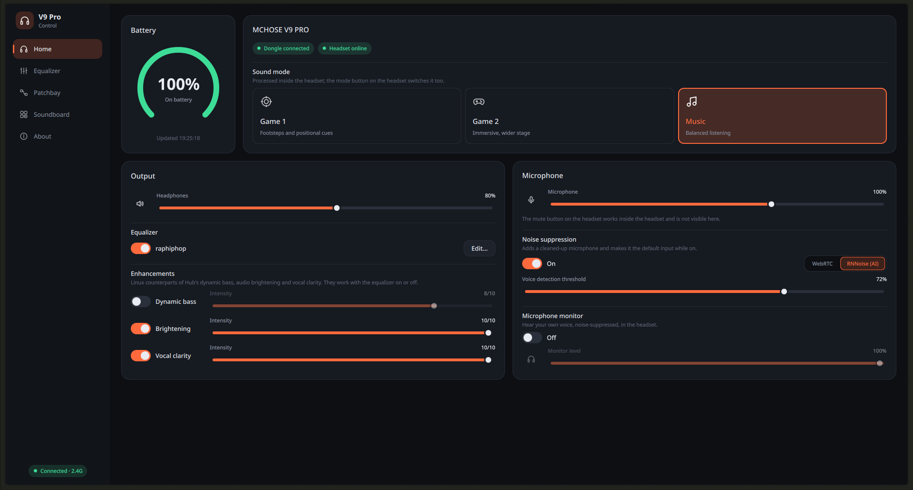
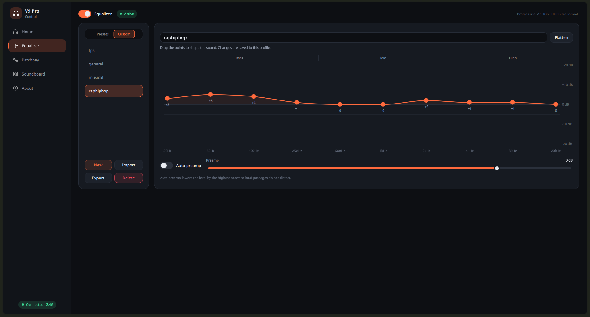
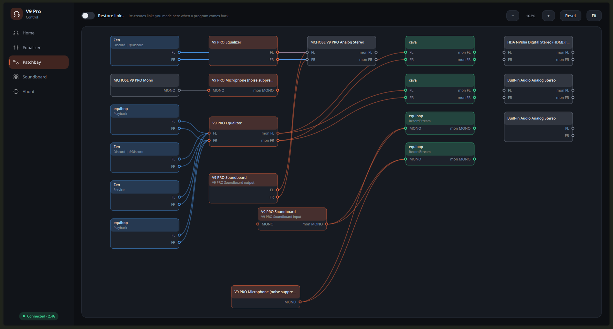
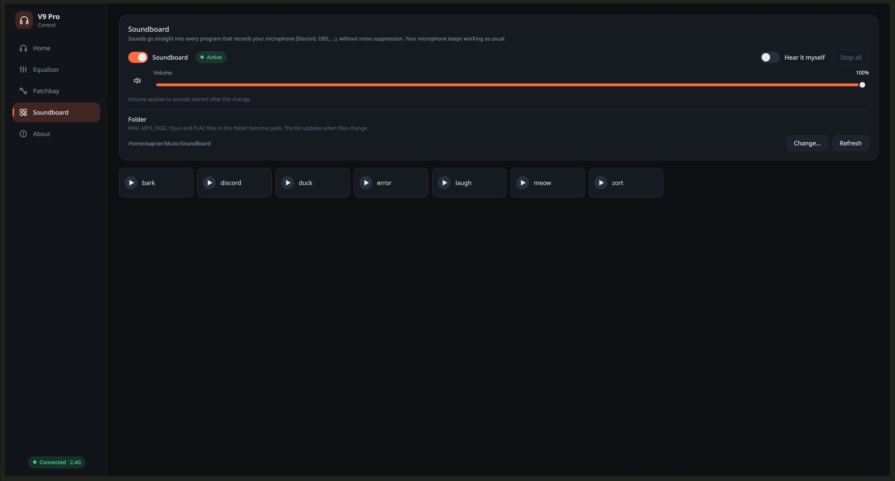

# V9 Pro Control

Unofficial Linux control application for the **MCHOSE V9 PRO** wireless headset
(USB `291d:385d`). MCHOSE HUB has no Linux version and does not work under Wine; this app talks to
the headset directly over hidraw and to PipeWire. No network access.

## Screenshots

| <br>**Home** | <br>**Equalizer** |
|:---:|:---:|
| <br>**Patchbay** | <br>**Soundboard** |

## Features

- Battery level and charge state (live, including pushes from the headset)
- Dongle / headset connection state
- On-device sound mode: Game 1, Game 2, Music
- Firmware versions of dongle and headset
- Headphone and microphone volume / mute (PipeWire)
- 10-band equalizer with MCHOSE HUB style presets and custom profiles (HUB's JSON format), auto preamp,
  and bass / brightening / vocal clarity enhancements (PipeWire filter-chain)
- Microphone noise suppression (WebRTC built in, RNNoise if installed)
- Microphone monitor (PipeWire loopback; follows noise suppression)
- Patchbay: qjackctl-style graph of PipeWire audio; drag cables between programs and devices (e.g. a
  browser into Discord's microphone), optionally re-creating them when programs restart
- Soundboard: pads from a folder, played into every program recording the microphone (bypassing noise
  suppression), optionally heard in the headset
- System tray: closing the window keeps the app (and the audio chains) running; the tray menu shows the
  battery, toggles the equalizer / noise suppression / monitor and quits. Start with `--hidden` to go
  straight to the tray, e.g. from autostart. Streams are moved back to the headset before quitting.

## Build

Requires Qt 6.8+ (Quick, QuickControls2, Widgets), CMake 3.21+, a C++20 compiler, and at runtime
`pactl` (pipewire-pulse), `pipewire`, `pw-cli`, `pw-dump`, `pw-link`, `pw-cat` / `pw-play`. Optional:
`noise-suppression-for-voice` for RNNoise, `ffmpeg` so the soundboard can play every format (Ogg Opus
included).

```bash
cmake -S . -B build -G Ninja -DCMAKE_BUILD_TYPE=Release
cmake --build build
ctest --test-dir build
./build/src/app/v9pro-control
# optional: binary, icon and .desktop entry
sudo cmake --install build
```

## Device access without root

```bash
sudo cp packaging/70-mchose-v9pro.rules /etc/udev/rules.d/
sudo udevadm control --reload && sudo udevadm trigger
```

Replug the dongle afterwards.
